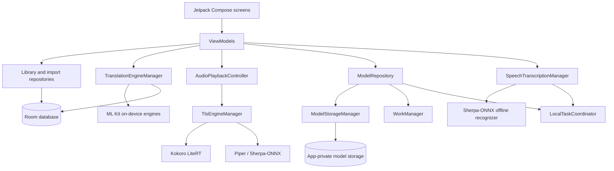

# Écoute — Architecture guide

This document describes the architecture visible in the current `main` branch. It is an implementation map, not a promise that every workflow is already complete or released.

## 1. Product boundary

Écoute is a local-first Android reading and language-learning application. The primary learning direction is English/French to Arabic. The application package contains the runtime and orchestration code; large speech and translation model packages are managed separately and are not bundled in the APK.

The baseline Android configuration is `minSdk 24` and `targetSdk 36`. Individual model packages can impose stricter requirements, including API level, 64-bit ABI, RAM, or accelerator support.

## 2. High-level component map

## 3. Main responsibilities

| Component | Responsibility |
|---|---|
| **Compose UI** | Presents library, reader, player, model-management, and file/document workflows. |
| **ViewModels** | Own screen state and coordinate user actions without embedding inference implementation in composables. |
| **Room / DAOs** | Persist books, chapters, sentences, vocabulary, model records, and progress-related data. |
| **LibraryRepository / BookImporter** | Import supported reading formats, normalize content, split it into readable units, and persist it. |
| **TranslationEngineManager** | Provides shared English→Arabic and French→Arabic translation engines to the reader and file-translation workflows. |
| **TtsEngineManager** | Resolves a compatible installed speech model, loads one active engine, reports runtime state, and releases engine resources. |
| **SpeechTranscriptionManager** | Decodes supported audio locally and runs Sherpa-ONNX offline recognition in bounded segments. |
| **ModelRepository** | Exposes model state, schedules downloads, checks compatibility, and reconciles model records with storage. |
| **ModelStorageManager** | Owns app-private model files, package verification, integrity manifests, safe installation, and recovery. |
| **LocalTaskCoordinator** | Provides a shared observable task ledger and coordinates expensive local work to reduce overlapping inference pressure. |
| **WorkManager** | Runs selected durable background workflows such as model downloads and file translation. |

## 4. Important execution flows

### Reading and translation

1. A screen action reaches its ViewModel.
2. The ViewModel obtains book/chapter/sentence state through repositories and Room flows.
3. Translation requests go through `TranslationEngineManager`.
4. The manager selects the English→Arabic or French→Arabic ML Kit engine.
5. Language packs are downloaded on demand and their readiness is exposed to the UI.
6. Successful translations can be cached with the sentence data for later display.

The translation manager is shared so the reader and file-translation path do not need separate translation-engine instances.

### Text-to-speech

1. The reader requests playback through `AudioPlaybackController`.
2. The controller asks `TtsEngineManager` to prepare the required language/model.
3. The manager checks model availability, integrity, language support, and device constraints.
4. It creates the relevant engine adapter (Kokoro LiteRT or Piper/Sherpa-ONNX).
5. Runtime state includes the loaded model, accelerator/fallback information, memory observations, and errors.
6. When work changes or ends, engine resources are cancelled/released rather than leaving multiple native engines resident.

### Offline audio transcription

1. The user selects an audio file.
2. The transcription manager decodes it locally to mono 16 kHz audio.
3. Sherpa-ONNX runs a compatible offline recognizer over bounded segments.
4. The resulting transcript is stored as an audio-backed library item so it can enter the reader workflow.

Transcription requires a compatible ASR model to be installed first. It is distinct from TTS: recognition converts audio to text; TTS converts text to speech.

### Model installation and integrity

1. A model catalog entry defines source, expected size, SHA-256, engine type, license metadata, language support, and device requirements.
2. The repository schedules the download and exposes progress/status.
3. Storage verifies the package before it is treated as installed.
4. Installation uses staging and recovery metadata so a failed replacement does not casually destroy a previously working model.
5. Startup reconciliation compares persisted model records with actual files and integrity state.

Model files remain in app-managed storage and are not source-controlled or embedded in the APK.

### Coordinated local tasks

`LocalTaskCoordinator` exposes task types, priorities, progress, status, and supported pause/resume/cancel/retry controls. It also serializes tasks that request the heavy-inference lock. This reduces the chance that speech recognition, TTS, and other memory-intensive native work all allocate their peak memory at once.

Not every asynchronous operation is automatically durable or resumable. A task's actual pause/retry guarantees depend on the worker or engine that owns it.

## 5. Resource lifecycle principles

- Verify downloaded model packages before loading them.
- Prefer one active heavy native inference engine at a time when device memory is constrained.
- Release native engine/session resources when no longer needed.
- Keep large models out of the APK and make model readiness explicit.
- Preserve the last known-good model while validating a replacement.
- Keep long-running background work separate from UI lifecycle where the workflow uses WorkManager.
- Treat cancellation and failure as explicit states; do not silently present partial output as success.

## 6. Offline capability boundaries

“Offline” is capability-specific, not a blanket statement that every screen works without a network connection.

| Capability | Offline condition |
|---|---|
| Reading already imported books | Content is stored locally. |
| TTS | A compatible speech model and its required assets are installed. |
| Speech transcription | A compatible ASR model is installed and the input format can be decoded locally. |
| Translation | The required ML Kit source/target language packs are downloaded and ready. |
| Model acquisition | Requires network access unless the model package is already available locally. |
| New app releases | Require network access to fetch the release. |

## 7. Verification and limits

The repository's Android CI workflow checks font coverage, JVM unit tests, Android Lint, Kotlin compilation, and debug APK assembly. These checks do not replace physical-device testing.

Important real-device validation areas include:

- Low-memory behavior and engine hand-off on ARM64 phones.
- Kokoro accelerator compatibility and CPU fallback.
- Piper voice quality and language coverage.
- Long audio transcription and large document handling.
- Background execution under Android battery restrictions.
- Arabic shaping, mixed Arabic/Latin layout, and text selection.
- Storage pressure, interrupted downloads, and model recovery.

For the exact current state, consult the source, [CI runs](https://github.com/youns03/-coute/actions), and [published releases](https://github.com/youns03/-coute/releases).
